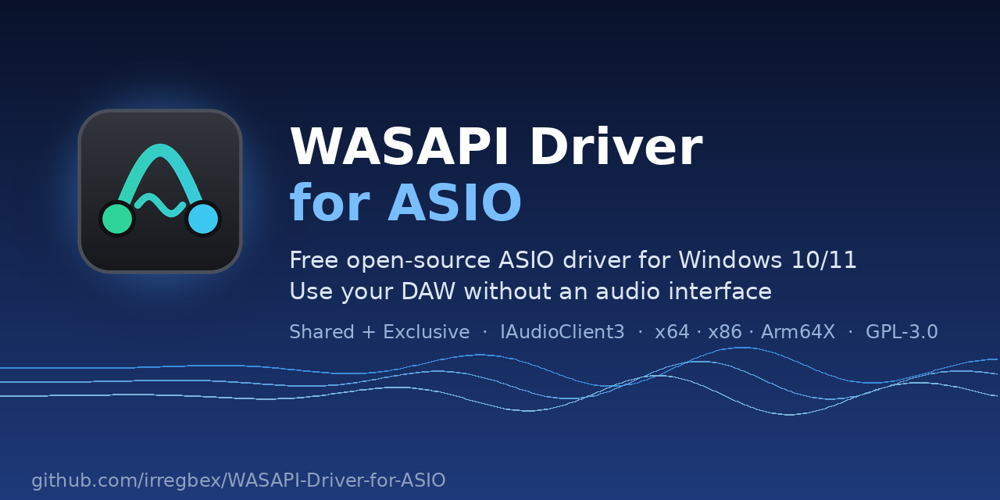

  

  
  
  
  
  
  

   
  <b>Use Cubase, Ableton Live, DaVinci Resolve and other ASIO hosts with the sound devices Windows already has.</b> 
  Built-in sound, USB headsets, HDMI monitors, Bluetooth headphones - no audio interface needed.

  <a href="https://github.com/irregbex/WASAPI-Driver-for-ASIO/releases"><b>Download</b></a> ·
  <a href="QUICK-START.txt">Quick start</a> ·
  <a href="FAQ.txt">FAQ</a> ·
  <a href="README.txt">Full manual</a> ·
  <a href="https://github.com/irregbex/WASAPI-Driver-for-ASIO/issues">Report a problem</a>

---

> [!NOTE]
> **Public beta (0.9.x).** The installer is not code-signed yet (signing through SignPath Foundation is in progress),
> so Windows SmartScreen may warn: choose **More info > Run anyway**. Download only from the
> [Releases page](https://github.com/irregbex/WASAPI-Driver-for-ASIO/releases) and compare the SHA-256 with `SHA256SUMS.txt`.

## Why this driver

Most DAWs talk to audio hardware through **ASIO**. Without an audio interface you are usually left with a driver that
takes the sound device **exclusively**: while the DAW is open, YouTube, calls, system sounds and screen recordings go silent.

**WASAPI Driver for ASIO** runs in **Shared mode by default**: your DAW and the rest of Windows play through the same
headphones or speakers at the same time. When you need the lowest latency, switch to **Exclusive** mode in one click.

## Features

| | |
|---|---|
| **Modern Windows audio** | WASAPI with the low-latency `IAudioClient3` engine at the device's native rate (typically 10 ms periods) |
| **Shared or Exclusive** | Shared by default (everything keeps playing); Exclusive for minimum latency |
| **Any project rate** | Internal 128-tap sinc conversion when the project rate differs from the device (e.g. 44.1 kHz project on a 48 kHz device) |
| **Bluetooth aware** | Detects Bluetooth outputs, recommends a buffer, latency offsets; keeps playing when headphones go into their case and come back |
| **Several devices** | Main device plus up to 3 extra inputs/outputs with clock-drift correction, output routing and loopback of a single application |
| **Monitoring and safety** | Direct monitoring, hearing-safety limiter, dither, live level meters and DSP load |
| **Control panel** | Profiles (also per program), floating monitor window, tray icon, 6 themes, 5 languages (EN/ES/PT/FR/DE), keyboard and screen-reader support |
| **Windows on Arm** | One **Arm64X** DLL serves native ARM64 hosts and emulated x64 hosts |
| **Troubleshooting** | Log file, Diagnostics tool, automatic ASIO host test, TraceLogging provider with a ready-made `.wprp` profile |
| **Privacy** | No telemetry. The optional update check is off by default ([PRIVACY.txt](PRIVACY.txt)) |

## Compared with the "Generic Low Latency ASIO Driver"

Cubase and Nuendo install Steinberg's *Generic Low Latency ASIO Driver*, a good compact fallback. This driver takes a different approach:

| | Generic Low Latency ASIO Driver | **WASAPI Driver for ASIO** |
|---|---|---|
| Other apps while the DAW is open | Exclusive: other apps go silent | **Shared by default**, Exclusive optional |
| Sample-rate conversion | soxr library | Built-in 128-tap sinc |
| Bluetooth | No special handling | Detection, buffer advice, latency offsets |
| Several devices | Port list | Up to 3 extra devices, drift correction, routing, app loopback |
| Windows on Arm | x64 only | x64, x86, ARM64, **Arm64X** |
| Diagnostics | - | Log, diagnostics, host test, TraceLogging |
| Source code | Closed | **Open (GPL-3.0)** |

The Generic driver has years of use on many machines; this driver is a public beta. Comparison with version 1.0.9.26 (x64).
The Generic Low Latency ASIO Driver is a product of Steinberg Media Technologies GmbH; this project is not affiliated with Steinberg.

## Install

1. Close your DAW.
2. Download **`WASAPI-Driver-for-ASIO-<version>-Setup.exe`** from [Releases](https://github.com/irregbex/WASAPI-Driver-for-ASIO/releases) and run it.
3. In your DAW, choose **WASAPI Driver for ASIO** as the ASIO driver
   (Cubase: *Studio > Studio Setup > Audio System*).
4. Open the driver's **Control Panel** to pick the output device, mode and buffer.

No reboot needed. A portable `bin.zip` with `install.bat` is also available. Full steps: [QUICK-START.txt](QUICK-START.txt).

## Tested with

| Host | Status |
|---|---|
| Cubase 15 (x64) - built-in, USB, HDMI and Bluetooth outputs | Tested: hours of use, Bluetooth on/off, sleep/resume |
| DaVinci Resolve Studio | Tested |
| Ableton Live, REAPER, FL Studio, Studio One, Bitwig | Not tested yet - reports welcome |
| Windows on Arm (Arm64X) | Built and verified in CI, **not tested on real hardware yet** - testers welcome |

See [COMPATIBILITY.txt](COMPATIBILITY.txt) and [KNOWN-ISSUES.txt](KNOWN-ISSUES.txt).

## Quality

- **Exception barriers** on every entry point: an internal error cannot crash your DAW.
- **Validation** of every call and argument from the host; bounded waits on device I/O.
- **18 offline test suites**, including fuzz tests under AddressSanitizer / UndefinedBehaviorSanitizer; a release is only built when all of them pass.
- Built in public by [GitHub Actions](https://github.com/irregbex/WASAPI-Driver-for-ASIO/actions) from this repository.
- Every review finding is documented in [CODE-REVIEW.txt](CODE-REVIEW.txt).

## Reporting a problem

Open an [issue](https://github.com/irregbex/WASAPI-Driver-for-ASIO/issues) and attach the **Diagnostics** report and, if possible,
a trace made with `Start trace.bat` / `Stop trace.bat` ([TRACING.txt](TRACING.txt)). Security problems: report them privately
(*Security > Report a vulnerability*, see [SECURITY.txt](SECURITY.txt)).

## Documentation

| Document | Contents |
|---|---|
| [QUICK-START.txt](QUICK-START.txt) | One page: install, select the driver, recommended settings |
| [README.txt](README.txt) | Complete manual |
| [FAQ.txt](FAQ.txt) | Common questions |
| [VERSION.txt](VERSION.txt) | Changelog |
| [BUILDING.txt](BUILDING.txt) / [ARCHITECTURE.txt](ARCHITECTURE.txt) | Building from source and how it works |
| [CODE-SIGNING-POLICY.txt](CODE-SIGNING-POLICY.txt) | Code signing policy and team roles |
| [CONTRIBUTING.txt](CONTRIBUTING.txt) | How to contribute |

## License

GPL-3.0-or-later - see [LICENSE.txt](LICENSE.txt), [COPYRIGHT.txt](COPYRIGHT.txt) and [THIRD-PARTY-NOTICES.txt](THIRD-PARTY-NOTICES.txt).

ASIO is a registered trademark of Steinberg Media Technologies GmbH ([TRADEMARKS.txt](TRADEMARKS.txt)).
Provided without any warranty ([DISCLAIMER.txt](DISCLAIMER.txt)); an audio driver can produce very loud sound - start at a low volume.
